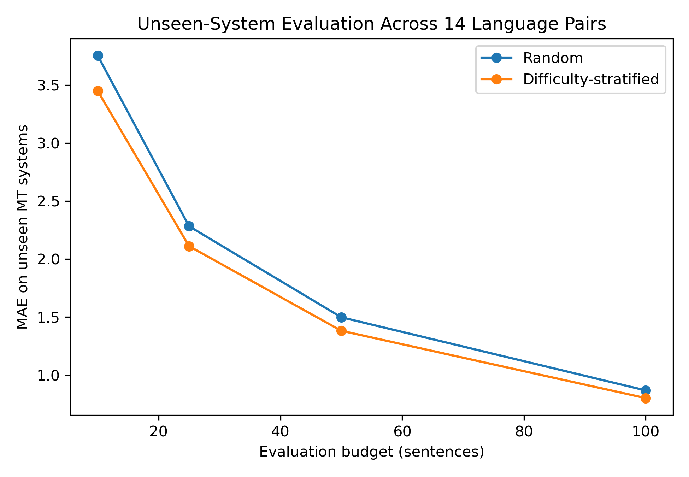
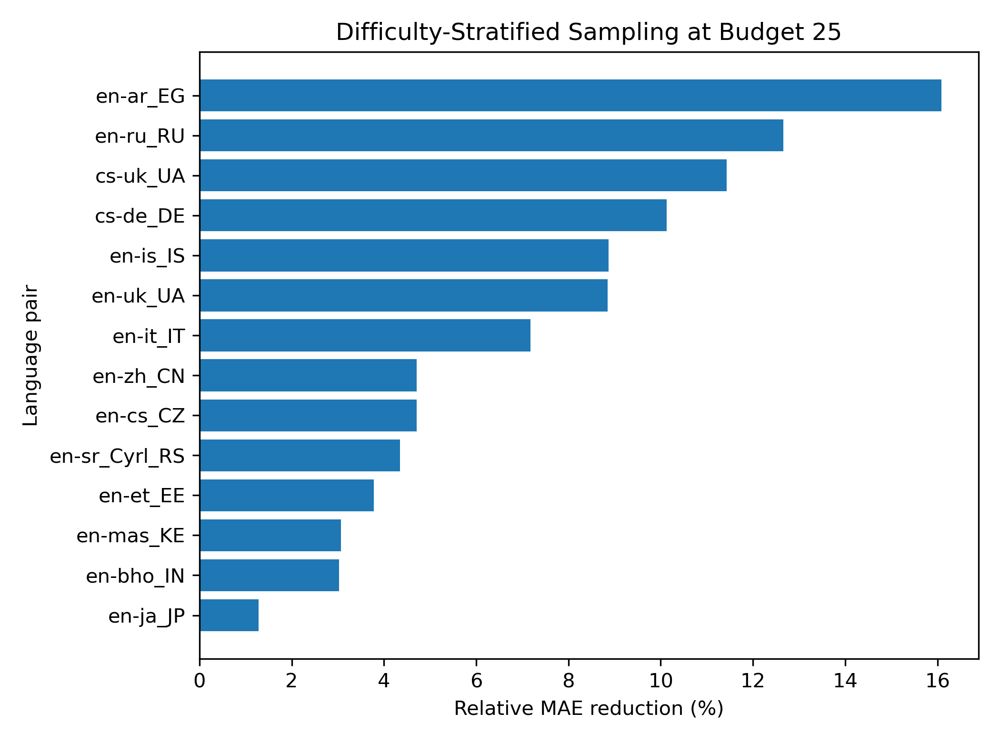
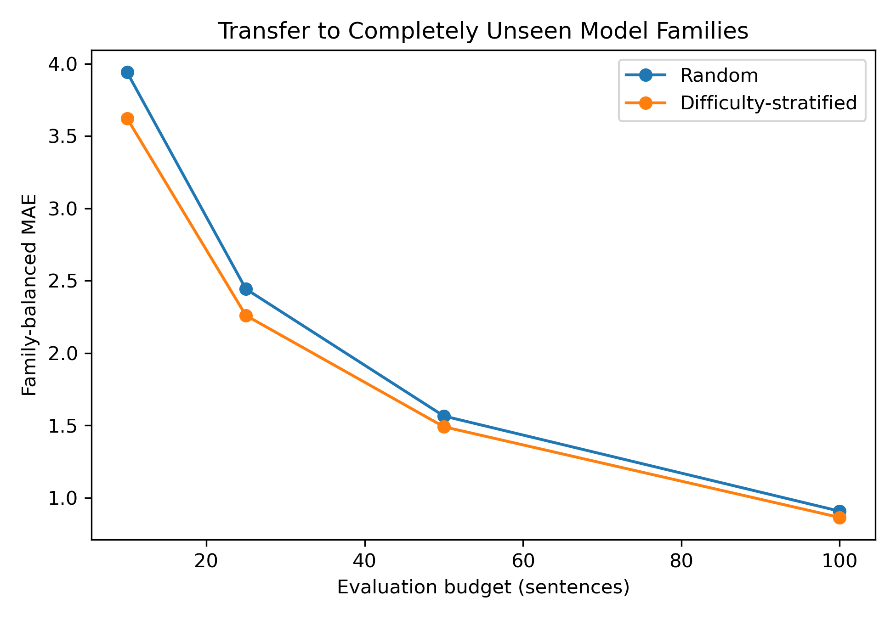
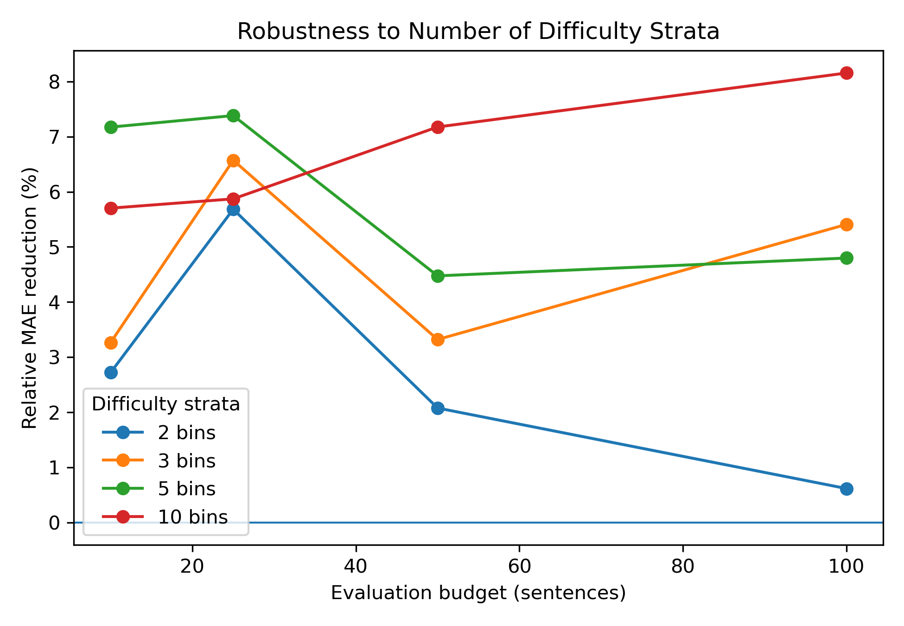

# Future-Proof Machine Translation Evaluation

**Difficulty-Stratified Test-Set Sampling for Unseen MT Systems**

**Researchers:** Taewoon Choi and Min-Hua Luo  
**Institution:** Johns Hopkins University  
**Status:** Research project / paper in preparation

## New class-project extension: stronger-system ranking

The [quality-shift experiment](experiments/quality_shift/README.md) asks whether
items selected using weaker systems can rank stronger held-out systems. Its
[multilingual extension](experiments/quality_shift/MULTILINGUAL.md) preserves the
six pilot selectors and uses the 13 non-pilot language directions as the primary
new-language comparison. The original score-estimation study below remains
separate; this extension does not claim to evaluate newly released models.

---

## Overview

Machine translation (MT) evaluation can become expensive when many systems must be evaluated on a large test set, especially when human judgments are involved.

This project studies a simple question:

> **Can we evaluate future or previously unseen MT systems using only a small subset of the full test set while still accurately estimating their full-test performance?**

We use human evaluation data from the **WMT25 General Machine Translation shared task** and study test-set selection under limited evaluation budgets.

Our main finding is that a simple **difficulty-stratified sampling** procedure consistently produces more accurate estimates of full-test MT quality than uniform random sampling.

The method uses existing MT systems only to estimate the difficulty distribution of test examples. It then samples across the entire difficulty spectrum rather than selecting only the hardest or most discriminative examples.

Importantly, the selected subset is evaluated on systems that were **not used during subset construction**, including experiments where **entire model families are held out**.

---

## Main Research Question

Let

- \(N\) be the number of test sentences,
- \(\mathcal{M}_{dev}\) be MT systems available during subset construction,
- \(\mathcal{M}_{test}\) be unseen MT systems,
- \(q_{ik}\) be the human quality score for sentence \(i\) and system \(k\).

For an unseen system \(k\), its full-test score is

\[
Q_k
=
\frac{1}{N}
\sum_{i=1}^{N} q_{ik}.
\]

Given an evaluation budget \(m \ll N\), we select a subset \(S_m\) and estimate

\[
\widehat{Q}_k(S_m)
=
\frac{1}{m}
\sum_{i \in S_m} q_{ik}.
\]

The primary objective is to minimize

\[
\mathrm{MAE}
=
\frac{1}{|\mathcal{M}_{test}|}
\sum_{k \in \mathcal{M}_{test}}
\left|
\widehat{Q}_k-Q_k
\right|.
\]

We additionally evaluate:

- Spearman rank correlation
- Kendall rank correlation
- Pairwise ranking accuracy

---

# Method

## Development-System Difficulty

For each test sentence \(i\), we calculate its average quality across development systems:

\[
\bar{q}^{dev}_i
=
\frac{1}{|\mathcal{M}_{dev}|}
\sum_{k \in \mathcal{M}_{dev}} q_{ik}.
\]

We define difficulty as

\[
D_i = -\bar{q}^{dev}_i.
\]

Lower development-system quality therefore corresponds to greater difficulty.

**No held-out-system score is used during sentence selection.**

---

## Difficulty-Stratified Sampling

Instead of simply choosing the globally hardest examples, we divide the test set into empirical difficulty quantiles.

Our primary configuration uses:

\[
B=5
\]

difficulty strata.

For an evaluation budget \(m\), approximately

\[
\frac{m}{B}
\]

sentences are sampled uniformly from each difficulty stratum.

Conceptually:

```text
Development MT systems
        ↓
Estimate sentence difficulty
        ↓
Sort test sentences by difficulty
        ↓
┌─────────────────────────┐
│ Very difficult          │
│ Difficult               │
│ Medium                  │
│ Easy                    │
│ Very easy               │
└─────────────────────────┘
        ↓
Sample across all strata
        ↓
Small evaluation subset
        ↓
Evaluate unseen MT systems
```

The goal is to preserve the **difficulty structure of the original test set**, rather than over-concentrating on extreme examples.

---

# Data

We use the public **WMT25 General Machine Translation human-evaluation data**.

Expected external data file:

```text
wmt25-general-mt/
└── data/
    └── wmt25-genmt-humeval.jsonl
```

Each record contains:

- source text,
- MT-system translations,
- human quality annotations,
- document/language-pair identifier.

When multiple human annotations are available for a sentence-system pair, we use their mean score.

The WMT human reference entry:

```text
refA
```

is excluded because it is a human reference, not an MT system.

Raw WMT data are **not duplicated in this repository**.

---

# Language Pairs

The main multi-language study uses 14 WMT25 language pairs:

```text
cs-de_DE
cs-uk_UA
en-ar_EG
en-bho_IN
en-cs_CZ
en-et_EE
en-is_IS
en-it_IT
en-ja_JP
en-mas_KE
en-ru_RU
en-sr_Cyrl_RS
en-uk_UA
en-zh_CN
```

These language pairs have complete human-score matrices for the systems used in our experiments.

Evaluation budgets are:

\[
m \in \{10,25,50,100\}.
\]

---

# Main Results

## 1. Random Unseen-System Transfer

For every language pair:

1. six MT systems are held out,
2. all remaining systems are used only to estimate difficulty,
3. subsets are selected without access to held-out scores,
4. subset estimates are compared with full-test scores of the unseen systems.

We evaluate **100 unique system splits per language pair**.

### Macro Average Across 14 Language Pairs

| Budget | Random MAE ↓ | Stratified MAE ↓ | Mean Relative MAE Reduction | Random Kendall | Stratified Kendall |
|---:|---:|---:|---:|---:|---:|
| 10 | 3.7536 | **3.4491** | **7.69%** | 0.6850 | 0.6903 |
| 25 | 2.2830 | **2.1115** | **7.15%** | 0.7940 | 0.7956 |
| 50 | 1.4983 | **1.3820** | **7.44%** | 0.8614 | 0.8629 |
| 100 | 0.8676 | **0.8015** | **7.19%** | 0.9173 | 0.9174 |

Difficulty-stratified sampling achieved lower MAE for:

\[
\boxed{14/14}
\]

language pairs at every tested budget.

The ranking metrics remain nearly unchanged, indicating that the primary gain is improved **absolute score estimation** rather than ranking accuracy.



---

## 2. Per-Language Consistency

At budget \(m=25\), stratified sampling improves MAE for **every language pair**.

The relative improvements range from approximately:

- **1.3%** for English → Japanese
- to **16.1%** for English → Arabic.



### Paired Cross-Language Significance

For all four budgets:

- 14/14 language pairs have lower MAE,
- the bootstrap confidence interval for mean improvement is above zero,
- the one-sided paired Wilcoxon signed-rank test gives

\[
p = 0.000061.
\]

Example for \(m=25\):

\[
\text{mean absolute MAE improvement}=0.1715
\]

with a 95% bootstrap confidence interval of approximately

\[
[0.111,\;0.242].
\]

---

# Model-Family Transfer

Random system holdout may still place closely related systems on both sides of the split.

We therefore perform a stronger experiment where **entire model families are excluded during subset construction**.

The family mapping includes:

### Gemma

```text
Gemma-3-12B
Gemma-3-27B
GemTrans
IRB-MT
UvA-MT
```

### Qwen

```text
Algharb
Wenyiil
Yolu
```

### CommandA

```text
CommandA
CommandA-MT
```

### EuroLLM

```text
CUNI-MH-v2
Laniqo
```

This produces:

- 13 Gemma language-family cases
- 10 Qwen cases
- 7 CommandA cases
- 2 EuroLLM cases

for a total of

\[
\boxed{32}
\]

eligible family-language holdouts.

---

## Family-Balanced Results

Because family coverage is unequal, results are first averaged within each family and then equally across families.

| Budget | Random MAE ↓ | Stratified MAE ↓ | Relative MAE Reduction | Improved Cases |
|---:|---:|---:|---:|---:|
| 10 | 3.9407 | **3.6224** | **7.17%** | 26 / 32 |
| 25 | 2.4430 | **2.2599** | **7.38%** | 26 / 32 |
| 50 | 1.5645 | **1.4902** | **4.47%** | 24 / 32 |
| 100 | 0.9065 | **0.8632** | **4.80%** | 27 / 32 |



### Clustered Bootstrap

We resample language pairs as clusters and give each model family equal weight.

95% confidence intervals for the absolute MAE improvement are:

| Budget | 95% CI |
|---:|---:|
| 10 | **[0.143, 0.497]** |
| 25 | **[0.126, 0.235]** |
| 50 | **[0.034, 0.128]** |
| 100 | **[0.024, 0.071]** |

All intervals remain above zero.

This provides evidence that difficulty information estimated from other MT systems can transfer even when an **entire model family is unseen**.

---

# Robustness to Number of Difficulty Strata

The primary method uses five strata.

We additionally test:

\[
B \in \{2,3,5,10\}.
\]

This experiment is a **sensitivity analysis**, not a procedure for selecting a new optimal value of \(B\).

The five-bin setting remains our pre-specified primary configuration.

### Family-Balanced Relative MAE Reduction

| Bins | Budget 10 | Budget 25 | Budget 50 | Budget 100 |
|---:|---:|---:|---:|---:|
| 2 | +2.72% | +5.68% | +2.08% | +0.62% |
| 3 | +3.26% | +6.57% | +3.32% | +5.41% |
| **5** | **+7.17%** | **+7.38%** | **+4.47%** | **+4.80%** |
| 10 | +5.70% | +5.87% | +7.18% | +8.16% |

All 16 bin-count × budget combinations have positive family-balanced MAE improvement.



---

# Exploratory Baselines

Before arriving at the final method, we investigated several alternatives.

### Difficulty-Only

Select the globally hardest sentences.

This strongly biases the evaluation distribution and produces poor absolute-score estimates.

### Disagreement-Only

For sentence \(i\),

\[
V_i
=
\operatorname{Var}
(q_{i1},\ldots,q_{iK}).
\]

High disagreement can identify discriminative examples but does not reliably preserve full-test scores for unseen systems.

### Difficulty + Disagreement

We also tested

\[
S_i
=
0.5\widetilde{D}_i
+
0.5\widetilde{V}_i.
\]

This continued to over-select extreme examples.

### Representative Disagreement

We stratified by difficulty and selected high-disagreement examples within each stratum.

This sometimes produced excellent rankings but still had worse absolute-score estimation than simple stratified random sampling.

---

## Example Pilot Result: Czech → German, Budget 25

| Method | MAE ↓ | Kendall τ ↑ |
|---|---:|---:|
| Uniform Random | 2.5405 | 0.8565 |
| Difficulty Only | 12.4890 | 0.7333 |
| Disagreement Only | 4.6963 | 0.7333 |
| Difficulty + Disagreement | 11.2490 | 0.4667 |
| Representative Disagreement | 3.8710 | **1.0000** |
| **Difficulty-Stratified Random** | **2.3341** | 0.8605 |

This illustrates an important distinction:

> **Ranking preservation and absolute score estimation are different objectives.**

A subset can rank systems correctly while still producing badly biased estimates of their actual full-test scores.

---

# Repository Structure

```text
future-proof-mt-evaluation/
│
├── README.md
├── requirements.txt
├── .gitignore
│
├── src/
│   ├── inspect_wmt25_schema.py
│   ├── audit_wmt25.py
│   ├── build_score_matrix.py
│   ├── random_baseline.py
│   ├── random_baseline_unseen.py
│   ├── create_pilot_system_split.py
│   ├── difficulty_baseline_unseen.py
│   ├── disagreement_baseline_unseen.py
│   ├── combined_difficulty_disagreement_unseen.py
│   ├── representative_disagreement_unseen.py
│   ├── stratified_random_unseen.py
│   ├── multisplit_benchmark.py
│   ├── multilanguage_benchmark.py
│   ├── analyze_multilanguage_significance.py
│   ├── audit_family_holdouts.py
│   ├── family_holdout_benchmark.py
│   ├── analyze_family_holdout_significance.py
│   ├── family_holdout_bin_robustness.py
│   └── make_paper_figures.py
│
├── results/
│   ├── score_matrices/
│   ├── random_baseline/
│   ├── random_baseline_unseen/
│   ├── difficulty_baseline_unseen/
│   ├── disagreement_baseline_unseen/
│   ├── combined_dd_unseen/
│   ├── representative_disagreement_unseen/
│   ├── stratified_random_unseen/
│   ├── multisplit_benchmark/
│   ├── multilanguage_benchmark/
│   ├── multilanguage_significance/
│   ├── family_holdout/
│   ├── family_holdout_benchmark/
│   ├── family_holdout_significance/
│   └── family_holdout_bin_robustness/
│
└── figures/
    └── paper/
        ├── fig1_multilanguage_mae.pdf
        ├── fig1_multilanguage_mae.png
        ├── fig2_per_language_improvement_m25.pdf
        ├── fig2_per_language_improvement_m25.png
        ├── fig3_family_holdout_mae.pdf
        ├── fig3_family_holdout_mae.png
        ├── fig4_bin_robustness.pdf
        └── fig4_bin_robustness.png
```

---

# Setup

## 1. Clone This Repository

```bash
git clone https://github.com/Apple32452/future-proof-mt-evaluation.git
cd future-proof-mt-evaluation
```

## 2. Clone the WMT25 Repository

The scripts assume the research repository and WMT25 repository are sibling directories:

```text
mt_subset_research/
├── future-proof-mt-evaluation/
└── wmt25-general-mt/
```

From the parent directory:

```bash
git clone https://github.com/wmt-conference/wmt25-general-mt.git
```

WMT25 uses Git LFS, so install it if necessary:

```bash
brew install git-lfs
git lfs install
```

Then:

```bash
cd wmt25-general-mt
git lfs pull
```

Verify that the human-evaluation file exists:

```bash
ls -lh data/wmt25-genmt-humeval.jsonl
```

---

## 3. Install Python Dependencies

```bash
cd ../future-proof-mt-evaluation

python -m venv .venv
source .venv/bin/activate

pip install -r requirements.txt
```

Main dependencies include:

```text
numpy
pandas
scipy
scikit-learn
matplotlib
```

---

# Reproducing the Experiments

## Inspect the Dataset

```bash
python src/inspect_wmt25_schema.py
```

## Audit WMT25 Human Evaluation Coverage

```bash
python src/audit_wmt25.py
```

## Build the Pilot Human-Score Matrix

```bash
python src/build_score_matrix.py
```

## Run Initial Baselines

```bash
python src/random_baseline.py
python src/create_pilot_system_split.py
python src/random_baseline_unseen.py
python src/difficulty_baseline_unseen.py
python src/disagreement_baseline_unseen.py
python src/combined_difficulty_disagreement_unseen.py
python src/representative_disagreement_unseen.py
python src/stratified_random_unseen.py
```

## Run 100 Unseen-System Splits

```bash
python src/multisplit_benchmark.py
```

## Run the 14-Language Benchmark

```bash
python src/multilanguage_benchmark.py
```

## Run Cross-Language Statistical Analysis

```bash
python src/analyze_multilanguage_significance.py
```

## Audit Eligible Model-Family Holdouts

```bash
python src/audit_family_holdouts.py
```

## Run Model-Family Transfer

```bash
python src/family_holdout_benchmark.py
```

## Run Family-Holdout Robustness Analysis

```bash
python src/analyze_family_holdout_significance.py
```

## Run Difficulty-Bin Sensitivity Analysis

```bash
python src/family_holdout_bin_robustness.py
```

## Generate Paper Figures

```bash
python src/make_paper_figures.py
```

Figures are written to:

```text
figures/paper/
```

---

# Key Takeaways

The experiments support three main conclusions.

1. **Selecting only hard or highly discriminative examples is not enough.**  
   Extreme-example selection can strongly distort absolute system scores.

2. **Preserving the difficulty distribution is consistently useful.**  
   Difficulty-stratified sampling reduces score-estimation MAE across all 14 evaluated language pairs.

3. **The effect transfers to unseen model families.**  
   Even when entire Gemma, Qwen, CommandA, or EuroLLM families are excluded during subset construction, difficulty stratification continues to reduce MAE on average.

The practical lesson is:

> When only a small MT evaluation budget is available, it can be more useful to preserve the full test set's difficulty structure than to select only its hardest examples.

---

# Reproducibility Notes

- The primary method uses **5 difficulty strata**.
- Five bins were fixed before the bin-count sensitivity experiment.
- Bin counts of 2, 3, 5, and 10 are used only for robustness analysis.
- Human-reference system `refA` is always excluded from MT-system rankings.
- Held-out-system scores are never used during subset construction.
- MAE is the primary metric.
- Ranking metrics are secondary diagnostics.
- Pilot Czech → German experiments were used during method development and should not be interpreted as untouched final test results.
- Multi-language and family-transfer experiments provide the main evidence.

---

# Current Research Status

The core experimental pipeline is complete.

Current paper-level evidence includes:

- 14-language unseen-system transfer
- 100 held-out-system splits per language pair
- paired cross-language significance testing
- complete model-family holdout
- 32 family-language transfer cases
- language-clustered / family-balanced bootstrap analysis
- difficulty-bin robustness analysis
- exploratory failure-mode ablations
- paper-quality figures

The manuscript is currently being prepared for an ACL-style research paper.

---

# Authors

**Taewoon Choi**  
Johns Hopkins University

**Min-Hua Luo**  
Johns Hopkins University

---

## Citation

This work is currently a research project / manuscript in preparation.

```bibtex
@misc{choi2026futureproofmt,
  title  = {Toward Future-Proof Machine Translation Evaluation:
            Difficulty-Stratified Test-Set Sampling for Unseen Systems},
  author = {Choi, Taewoon and Luo, Min-Hua},
  year   = {2026},
  note   = {Manuscript in preparation}
}
```
